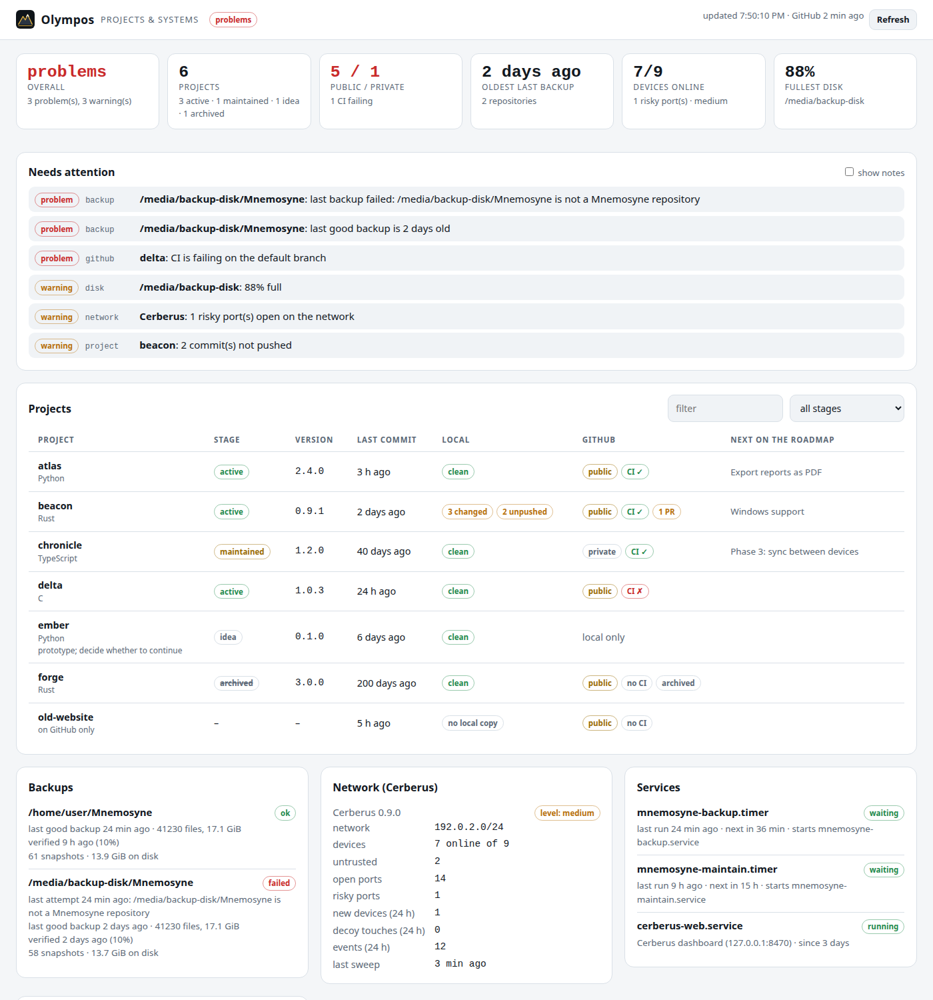
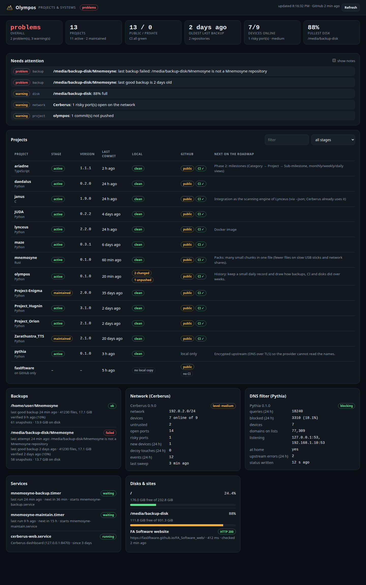
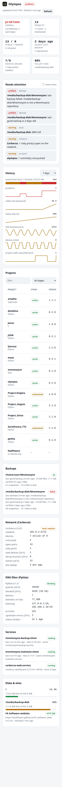
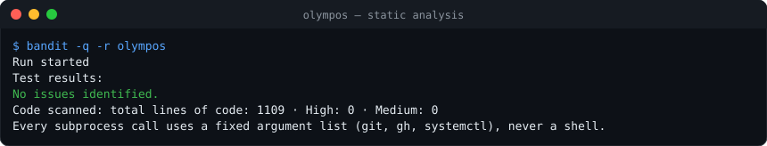
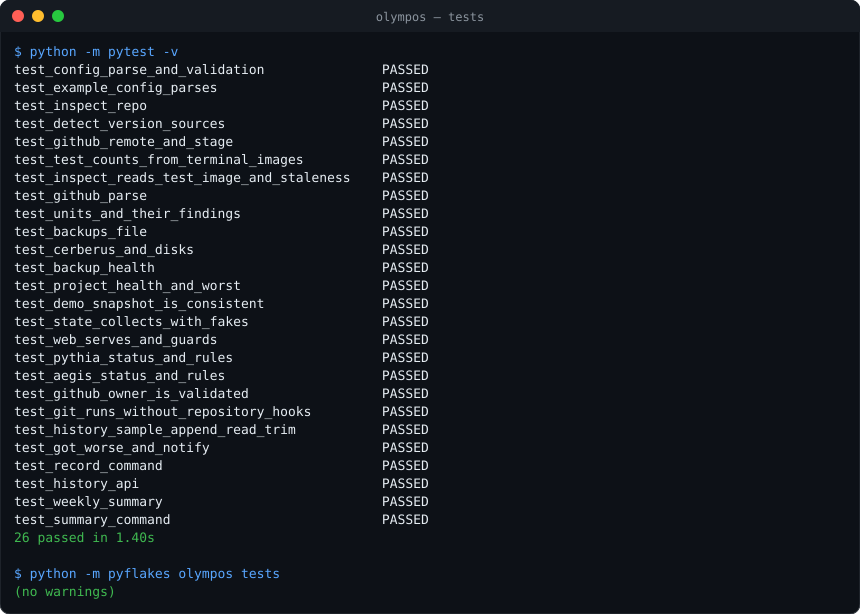

# Olympos

[](https://github.com/fas0ftware/olympos/actions/workflows/ci.yml)


One page that shows how every project and home system is doing: which projects are
active, what is uncommitted or unpushed, which CI is red, whether last night's backup
really happened and was verified, what the home network watcher saw, how full the disks
are and whether the website is up. Things that need attention come first.

Named after the mountain where the Greek gods sat and watched over everything.



<details>
<summary>Dark theme and phone</summary>




</details>

The screenshots use the built-in demo data (`--demo`): the author's own public projects with their real
versions and roadmaps, on a made-up machine (paths, times, backups and network are fictional).

## Contents

- [What it shows](#what-it-shows)
- [Quick start](#quick-start)
- [History and notifications](#history-and-notifications)
- [Settings](#settings)
- [What counts as a problem](#what-counts-as-a-problem)
- [Security and privacy](#security-and-privacy)
- [Testing](#testing)
- [Project layout](#project-layout)
- [Roadmap](#roadmap)

## What it shows

| Area | Source | Details |
|---|---|---|
| **Projects** | every git repository under the configured folders (two levels deep) | language, version (`Cargo.toml`, `pyproject.toml`, `package.json`, `__version__`, or the README version badge), branch, uncommitted files, unpushed / unpulled commits, last commit, the first open item of the README's *Roadmap*, the number of passed tests (from the project's `docs/test-results.svg` terminal image, with a note when the code has moved on since it was made), and a stage |
| **Stage** | commit activity, or your own label | *active* (commit in the last 14 days), *maintained* (90 days), *paused*; *archived* when archived on GitHub; or set `idea / active / maintained / paused / archived` yourself |
| **GitHub** | one GraphQL query per owner through the logged-in `gh` CLI | public / private, CI result on the default branch with how many of its jobs passed and the names of the failing ones, open pull requests, archived; repositories with no local copy are listed too |
| **Backups** | [Mnemosyne](https://github.com/fas0ftware/mnemosyne)'s status file | last attempt, last *good* backup, last verification, snapshots, size |
| **Services** | `systemctl --user show` | for a timer also the result of the job it last started (a timer can be "active" while every backup fails) |
| **Network** | a local [Cerberus](https://github.com/fas0ftware) dashboard (`/api/summary`) | devices online, risky ports, decoy touches, alert level |
| **DNS filter** | [Pythia](https://github.com/fas0ftware/pythia)'s status file | blocking or paused, queries and blocks in 24 h, upstream health; "stopped" when the file is more than 3 minutes old |
| **Laptop security** | Aegis's status file (`python -m aegis --save`) | score, and the checks that fail or warn; a failing *high* check (firewall off, disk not encrypted, security updates waiting) is a problem, other failures are warnings; a warning when the last audit is more than 2 days old. Only titles and one-line summaries are read, never Aegis's details or fix commands |
| **Laptop events** | Themis's status file (`themis scan --save`, every 5 minutes from its timer) | the last 24 hours of failed logins, sudo misuse, SSH, brute force, new USB devices (a new *keyboard* is BadUSB) and services that ran for the first time; high events are problems, medium ones a warning, a warning when Themis has not written for 30 minutes. Event texts are capped again on reading |
| **Disks** | `statvfs` | free space, or "not mounted" for an unplugged backup disk |
| **Websites** | an HTTP `HEAD` | status code and response time |

Local data is re-read every 20 seconds at most; GitHub and websites every 5 minutes, in
the background, so the page never waits for the internet.

## Quick start

Standard library only, Python 3.11+.

```bash
python -m olympos serve --demo          # try it with fictional data: http://127.0.0.1:8746

cp olympos.example.toml olympos.toml    # or ~/.config/olympos/olympos.toml
$EDITOR olympos.toml                    # your project folders, units, disks, sites
python -m olympos                       # summary in the terminal
python -m olympos serve                 # the page
python -m olympos json                  # everything as JSON, for scripts
```

`python -m olympos` exits with 0 when everything is fine, 1 for warnings and 3 for
problems, so it can drive a status-bar indicator or a cron mail.

```text
$ python -m olympos status --demo
Olympos 0.1.0: BAD · 13 projects · 13 public / 0 private on GitHub · 2 problem(s), 3 warning(s)

  ✗ /media/backup-disk/Mnemosyne: last backup failed: /media/backup-disk/Mnemosyne is not a Mnemosyne repository
  ✗ /media/backup-disk/Mnemosyne: last good backup is 2 days old
  ! /media/backup-disk: 88% full
  ! Cerberus: 1 risky port(s) open on the network
  ! olympos: 1 commit(s) not pushed

  ariadne              1.1.1    active      ci ✓ public
  daedalus             0.2.0    active      ci ✓ public
  janus                1.9.0    active      ci ✓ public
  JUDA                 0.2.2    active      ci ✓ public
  ...
```

## History and notifications

`python -m olympos record` saves one small sample (numbers only: level, problem and
warning counts, the oldest last backup, the fullest disk, Pythia and Cerberus counts,
projects with unpushed work) to `~/.local/state/olympos/history.jsonl`, kept for 90
days. When the overall level got worse since the previous sample, or stayed bad with
more problems, it shows a desktop notification with the top findings (`notify-send`);
nothing repeats while things stay the same.

A timer runs it every 15 minutes, so the history grows even while the page is closed:

```bash
cp contrib/systemd/olympos-record.* ~/.config/systemd/user/
$EDITOR ~/.config/systemd/user/olympos-record.service     # WorkingDirectory = your checkout
systemctl --user daemon-reload && systemctl --user enable --now olympos-record.timer
```

The page draws the samples of the last day, week or month: the overall level as a
coloured strip and a line for each number.

`python -m olympos summary [--days 7] [--notify] [--json]` turns the history into a short
report: better, worse or steady; how much of the time things were green, yellow and red;
how long CI was red; the longest stretch without a good backup; how the fullest disk grew;
DNS blocks per day; and what is still open now. `contrib/systemd/olympos-summary.timer`
sends it as a notification every Monday at 09:00.

```text
$ python -m olympos summary --demo
Last 7 days: worse. Green 0%, yellow 59%, red 41% of the time.
Problems: 0 at the start, 2 now (at most 2).
CI was red for about 20.2 h.
Backups: the longest gap reached 48.0 h.
Fullest disk: 84% → 88%.
DNS filter: about 3,050 blocked per day.
Still open:
  ✗ /media/backup-disk/Mnemosyne: last good backup is 2 days old
  ...
```

## Settings

`olympos.toml` describes your machine, so it is in `.gitignore`. The annotated template
is [`olympos.example.toml`](olympos.example.toml):

```toml
roots = ["~/projects"]

[services]
units = ["mnemosyne-backup.timer", "mnemosyne-maintain.timer"]

[backups]
max_age_hours = 3          # a last good backup older than this is a problem
check_max_age_days = 3     # data should be re-verified at least this often

[cerberus]
url = "http://127.0.0.1:8470"

[disks]
paths = ["/", "/media/backup-disk"]
warn_percent = 85

[[sites]]
name = "Website"
url = "https://example.github.io/"

[projects.my-old-tool]
stage = "archived"
note = "replaced by my-new-tool"
```

## What counts as a problem

| Level | Examples |
|---|---|
| **problem** | CI failing (with the failing job names); a backup failed, is older than `max_age_hours` or never succeeded; a verification found damage; a service failed or is not installed; the last job a timer started failed; a disk is not mounted or 95 % full; a website is down; decoy touches or high alerts in Cerberus; a failing *high* Aegis check; a high Themis event in the last 24 h |
| **warning** | unpushed commits; a timer that is not running; data not verified for `check_max_age_days`; a disk over `warn_percent`; risky ports on the network; Cerberus not reachable; another failing Aegis check or an Aegis audit older than `max_age_days`; medium Themis events, or no Themis scan for `max_age_minutes`; a git or GitHub error |
| **note** (hidden unless *show notes*) | uncommitted files, a feature branch, open pull requests, commits to pull, a project with no GitHub repository yet, new devices on the network, Pythia away from home, Aegis checks with a warning, a test image 5 or more code commits older than the code |

## Security and privacy

- Listens on **127.0.0.1 only**. The `Host` header must be `127.0.0.1:<port>` or
  `localhost:<port>` (DNS rebinding), the only POST (`/api/refresh`) must come from the
  page itself with JSON (CSRF), and every response carries a strict
  Content-Security-Policy. All values are inserted as text, never as HTML.
- **Read-only.** It never changes a repository, never fetches, never starts or stops a
  service. Every subprocess (`git`, `gh`, `systemctl`) gets a fixed argument list, no shell.
- **No tokens of its own.** GitHub goes through your existing `gh` login. Cerberus is read
  without a token, which Cerberus only allows from the machine itself, so the setting
  accepts only a `127.0.0.1` / `localhost` address.
- Your settings (paths, unit names, sites) stay in the ignored `olympos.toml`.



## Testing

```bash
pip install -r requirements-dev.txt
python -m pytest -q
python -m pyflakes olympos tests
bandit -q -r olympos
```



The tests build real git repositories (with a bare remote, unpushed and uncommitted
work, an empty repository, overlapping roots), feed recorded `systemctl show` output,
GitHub GraphQL answers and Mnemosyne status files, check every health rule, and run the
web server on a free port to test the Host, Origin and Content-Type guards and path
traversal. CI also runs the demo end to end on Python 3.11 to 3.13.

## Project layout

```text
olympos/
  __main__.py   CLI: status (default), json, serve; --demo
  config.py     olympos.toml
  projects.py   local git repositories: version, language, state, roadmap, stage
  github.py     one GraphQL query per owner via gh
  systems.py    systemd units, Mnemosyne, Cerberus, Pythia, Aegis, Themis, disks, websites
  health.py     findings and the overall level
  state.py      caching; GitHub and sites refreshed in the background
  demo.py       fictional data for screenshots
  web.py        routes; web_base.py: the shared local web server
  static/       page, styles, script
```

## Roadmap

- ~~History: keep a small daily record and draw how backups, CI and disks did over weeks.~~ Done in 0.2.
- ~~Desktop notification when the overall level gets worse.~~ Done in 0.2.
- ~~Weekly summary (what got better, what is still open).~~ Done in 0.3.
- ~~Tests per project and the failing CI jobs by name.~~ Done in 0.4: the count is read from each
  project's test image, because downloading CI logs needs a token per run and the image is already
  in the repository.
- ~~Laptop security from Aegis.~~ Done in 0.5: score, failing checks as findings, score in the history.
- ~~Laptop events from Themis.~~ Done in 0.6: high events as problems, a panel, events per day in the history.
- Coverage per project. None of the projects publishes a coverage number yet; this waits until
  their CI does (for example a `coverage.json` artifact).

## License

MIT
